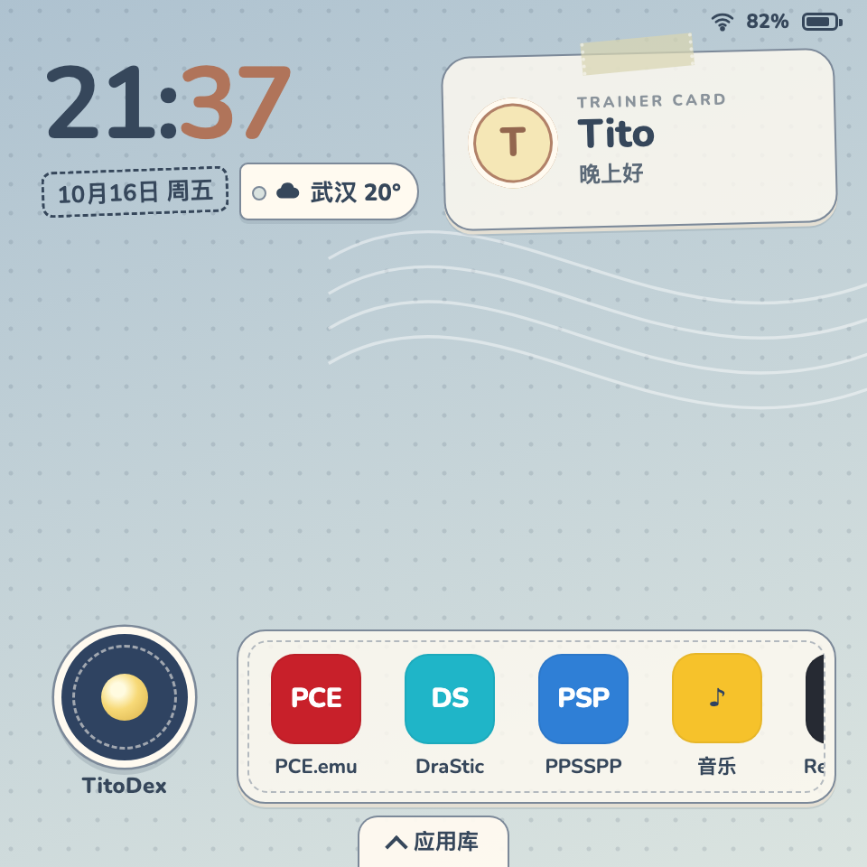
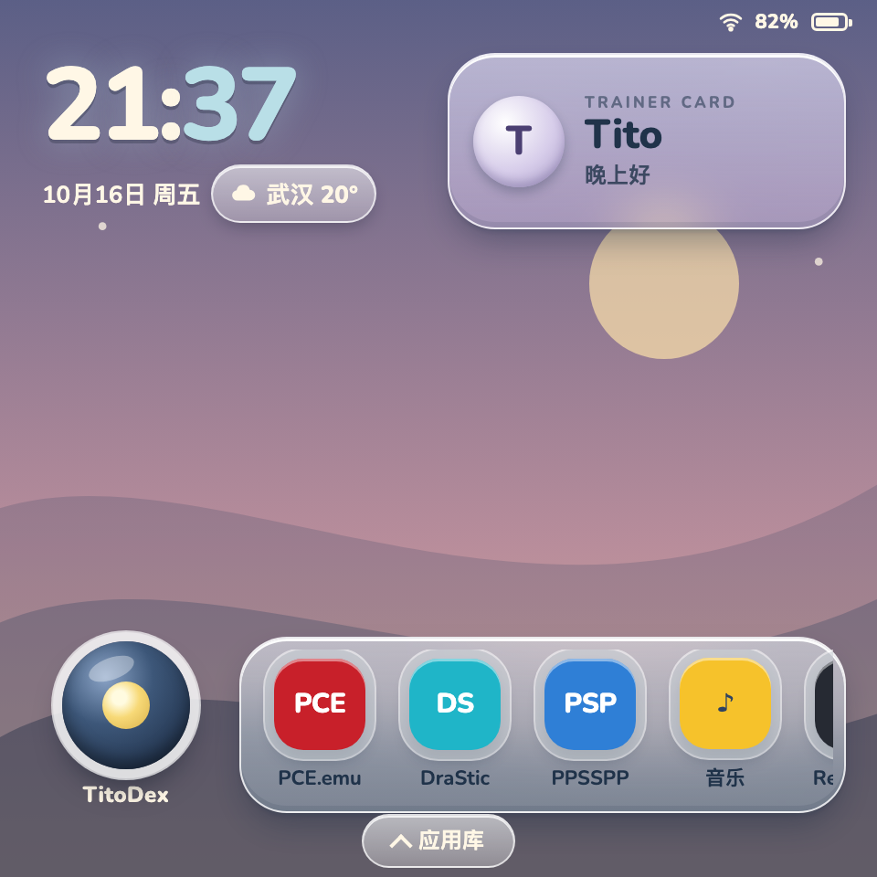
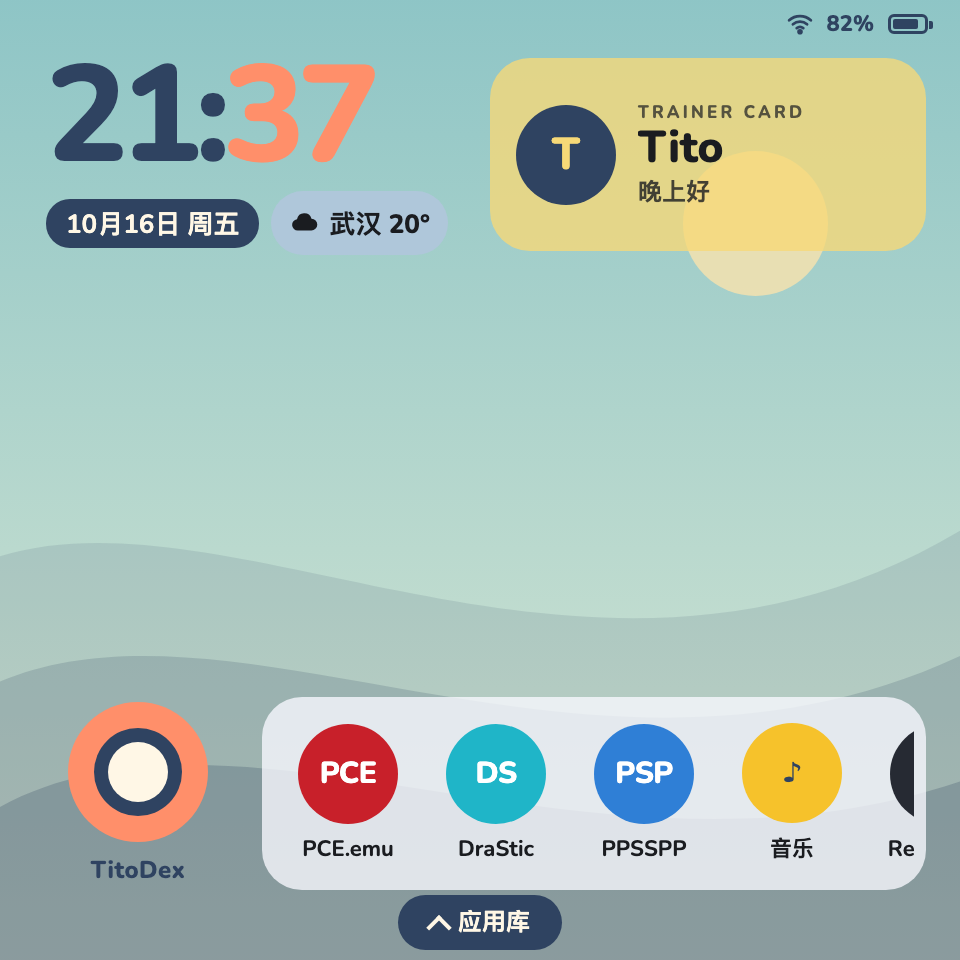
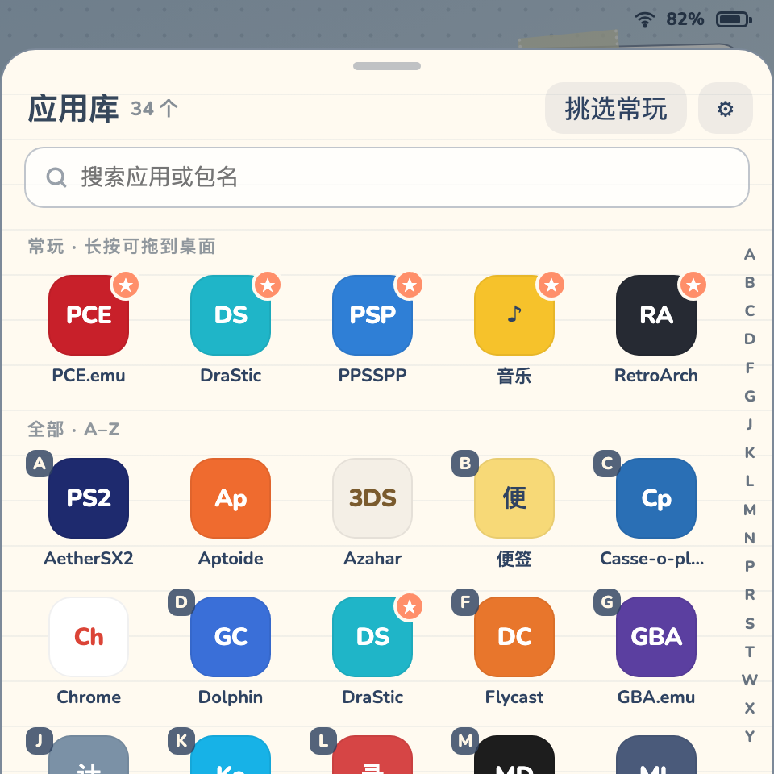
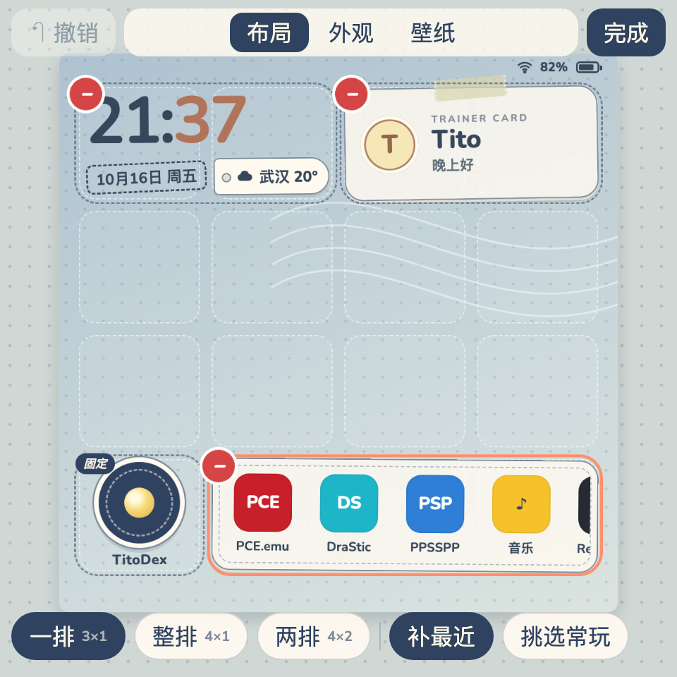
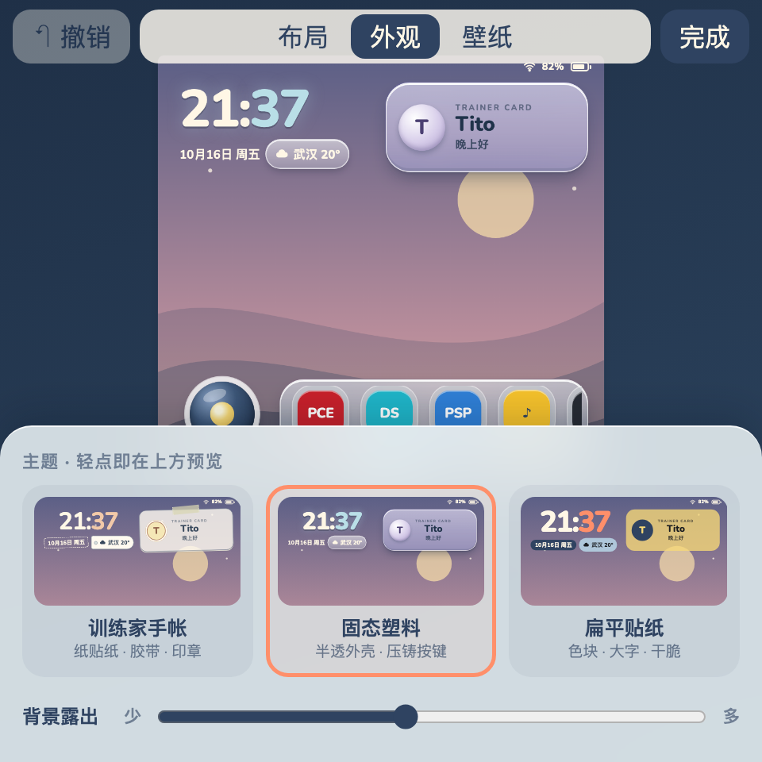

# TitoDex Launcher 0.3 方向：壁纸上的贴纸桌面

状态：方向提案，等待用户确认后再进入 Flutter 实现。配套可交互原型 [`prototype.html`](prototype.html)，状态草图在 [`sketches/`](sketches/)，由 [`capture.sh`](capture.sh) 从原型重新生成。原型只用于验证信息架构与触屏流程，图标、天气、时间都是示例数据。

## 一句话主张

**壁纸是主角，桌面上只放几张有各自形态的贴纸；整理和换装在原处完成，所见即所得，随时可以撤销。**

## 1. 现状问题（0.2.0）

依据：源码（`home_page.dart`、`layout_editor.dart`、`settings_page.dart`、`models.dart`），以及 2026-10-17 在 RG Rotate 真机上看到的 0.2.0 实际状态（用户自选照片壁纸、常玩为空、表面浓度 100%）。

| 方面 | 问题 |
| --- | --- |
| 主次 | Trainer、TitoDex、常玩都是同一种奶油色圆角面板、同一套字号，看不出谁最重要。TitoDex 只是换了底色的同款卡片。 |
| 背景露出 | 三块面板加底部 Dock 约占全屏 40%，而且集中在中下部，真机上照片壁纸的主体被挡住大半。 |
| 通透感 | 只有一个全局「表面浓度」（70–100%）。用户把它拉到了 100%：调透明只会让面板发灰，真正的通透来自少覆盖，而不是更透明。 |
| 空状态 | 常玩为空时仍占满整行，只显示一句「把喜欢的应用放在这里」。 |
| Dock | 「应用库 / 搜索 / 编排 / 设置」四个大按钮常驻一行。搜索与应用库重复，编排和设置都是低频操作，却占着最好的位置。 |
| 编排 | 「编排桌面」是一张独立表单：开关、半宽 / 整行、上下箭头。改动时看不到桌面效果；模块只能按顺序流式排列，无法把留白放到壁纸主体所在的位置。 |
| 外观 | 主题、壁纸、效果藏在长设置页里，与布局分离，没有预览，也没有撤销；预设会直接重排模块。 |
| 主题性格 | 三个主题主要差在表面色、圆角和阴影，组件和布局完全相同，换主题不像"换了一台机器"。 |
| 应用库 | 全屏页面加「全部 / 收藏」筛选，收藏管理还分散在设置的「整理收藏」里。真机上 54 个应用，一屏只能看到约 10 个。 |
| 可发现性 | 「长按空白处编排」只写在按键提示里；上滑打开应用库只在时钟下方一条留白区有效。 |

## 2. 设计原则

1. **少覆盖。** 默认排布里不透明表面约占屏幕四分之一，中间两行留给壁纸。「背景露出」滑杆只作为第二层调节。
2. **每个元素有自己的形态。** 不用通用卡片：
   - 时间直接写在壁纸上；
   - Trainer Card 是一张名片；
   - TitoDex 是一颗实体按键；
   - 常玩是一排货架。
3. **一个入口一个职责。** 去掉 Dock。上滑或「应用库」把手打开应用库，长按进入整理，设置退居二线。
4. **原位编辑。** 布局、外观、壁纸都在同一个「整理桌面」模式里调整，桌面本身就是预览。
5. **任何修改都能撤回。** 整理中可以逐步撤销，完成后还能一键撤销整次整理；桌面上的快捷修改都附带「撤销」提示。
6. **触屏优先，按键对等。** 每个触屏流程都有对应的手柄路径，按键提示只在使用手柄时出现。

## 3. 信息架构

```
首页（壁纸 + 网格上的贴纸）
├─ 上滑壁纸 / 轻点「应用库」把手 / Y ──→ 应用库（覆盖在首页上的底部抽屉）
│     ├─ 搜索（Y 直接聚焦，Enter 打开第一个结果）
│     ├─ 常玩区 → 全部 A–Z（连续网格 + 首字母角标 + 右侧字母条）
│     ├─ 长按应用 → 菜单（打开 / 加入或移出常玩 / 应用信息）；继续拖动 → 放到首页常玩架
│     └─ 「挑选常玩」→ 多选模式（最多 12 个，完成后可撤销）
├─ 长按空白壁纸 / 长按贴纸 / Start ──→ 整理桌面（同一桌面缩小居中，顶部 撤销 · 标签 · 完成）
│     ├─ 布局：拖动、选中换尺寸、− 隐藏、托盘找回、起始排布（漫游 / 面板 / 留白）
│     ├─ 外观：主题（缩略图就是你当前的布局）、背景露出、动态效果、按键提示
│     └─ 壁纸：主题默认 / 海岸 / 暮色 / 森林 / 我的照片 / 选照片…、效果、恢复默认背景
├─ 轻点贴纸内容 ──→ 就地小浮层（称呼和签名；天气刷新、换城市、关闭）
├─ 长按常玩图标 ──→ 菜单；继续拖动排序，拖到顶部移出
└─ 设置（Select / 应用库 ⚙ / 整理托盘 ⚙）：默认桌面、系统入口、天气城市、手柄、性能、恢复全部默认、关于
```

设置页顶部明确提示：「主题、壁纸、贴纸排布都在整理桌面里调整」，并提供「去整理」入口，避免两个地方都能改外观。

## 4. 首页布局

方屏 480×480 logical（RG Rotate 720×720 @240dpi）用 4×4 网格，单格约 114×107；横屏 800×450 用 6×3。贴纸吸附网格，只提供几档尺寸，每档对应一种形态，而不是简单拉伸：

| 贴纸 | 方屏可选尺寸 | 形态变化 |
| --- | --- | --- |
| 时间天气 | 紧凑 2×1、大字 2×2、横幅 4×1 | 无底板，直接写在壁纸上；大字档上下排两行数字 |
| Trainer Card | 徽章 1×1、名片 2×1、完整 2×2 | 徽章只显示头像和称呼；完整档加上一句签名 |
| TitoDex | 按键 1×1、带标签 2×1 | 圆形实体按键加金色镜头；**固定，不能隐藏** |
| 常玩 | 一排 3×1、整排 4×1、两排 4×2 | 图标货架，末尾是「全部」；为空时只显示一个「挑选常玩」虚线格 |

主次：TitoDex 按键是这台机器的"实体键"，形态最特别，也是手柄的默认焦点；Trainer Card 负责问候和身份；常玩负责效率；时间天气作为壁纸上的排版，存在感最低。

起始排布（只重排贴纸，不动称呼、常玩和壁纸，并且可以撤销）：

| 排布 | 方屏 | 用意 |
| --- | --- | --- |
| 漫游（默认） | 时间左上，名片右上，TitoDex 和常玩在底行，中间两行留空 | 最大化壁纸 |
| 面板 | 横幅时间、名片加带标签 TitoDex、两排常玩 | 应用多、重效率 |
| 留白 | 大字时间、名片默认隐藏、一排常玩加 TitoDex | 极简 |

方屏和横屏各自保存一份布局，旋转后不会互相挤乱。



## 5. 三个主题的性格

不只是换颜色：每个主题都有自己的材质、装饰和编辑时的动效。

| | 训练家手帐 | 固态塑料 | 扁平贴纸 |
| --- | --- | --- | --- |
| 隐喻 | 贴在旅行手帐上的纸片 | 半透明外壳的掌机实体 | 平面海报和色块贴纸 |
| 表面 | 纸色加细灰蓝描边，2px 纸边阴影 | 磨砂半透，内高光加模压阴影 | 纯色块，无描边无阴影 |
| 特征装饰 | 名片斜贴 -1.4°，顶部一条胶带；日期是虚线印章；天气像行李牌 | TitoDex 是带高光的压铸圆键；常玩图标嵌在凹槽里 | 时钟更大（68px）；名片是黄色块；TitoDex 是珊瑚色圆键；图标是圆形 |
| 默认背景 | 点阵纸和邮戳波纹 | 蓝灰渐变加光斑 | 浅灰底和几何色块 |
| 整理时 | 贴纸轻微晃动，像没贴牢的纸 | 贴纸微缩，像按下去的键 | 不晃动，只显示描边 |
| 手柄焦点 | 黄色荧光笔描边 | 外发光 | 粗黑描边 |

强调色会根据壁纸深浅自动切换，保证时钟分钟数在浅色或深色壁纸上都能看清（真机上发现塑料主题配海岸壁纸时看不清，已修复）。

<p>
  
</p>

## 6. 关键触屏流程

| 任务 | 0.2.0 | 0.3 方案 |
| --- | --- | --- |
| 打开应用库 | 点 Dock「应用库」，或只在时钟下方那条留白区上滑 | 在壁纸任意位置上滑，或点底部「应用库」把手 |
| 返回桌面 | 左上返回或 B | 下拉把手 / 标题区下拉 / 列表滚到顶后继续下拉 / 点遮罩 / B / Home |
| 加入常玩 | 应用库 → 长按 → 收藏 | 同样三步；或长按后直接拖到桌面常玩架；批量用「挑选常玩」 |
| 常玩排序 | 设置 → 整理收藏 → 拖动或上下按钮 | 在桌面长按图标直接拖动；拖到顶部即移出 |
| 进入整理 | Dock「编排」或长按空白（只写在提示里） | 长按空白壁纸；长按任意贴纸会直接进入并拿起它；首次使用有引导 |
| 移动模块 | 只能在列表里调整顺序 | 一次连续手势：长按贴纸并拖到任意空格；落到别的贴纸上会交换 |
| 调整大小 | 半宽 / 整行两档 | 轻点选中，在托盘里选尺寸，形态随之变化；放不下时就近找空位 |
| 隐藏和找回 | 列表开关 | 点贴纸角上的 −；从托盘「＋ 名称」找回 |
| 换主题 | 设置页里改，看不到效果 | 整理 → 外观 → 点主题卡，桌面立刻换装；卡片缩略图就是你当前的布局 |
| 换壁纸或效果 | 设置页里改 | 整理 → 壁纸，即时生效；「恢复默认背景」也能撤销 |
| 改错了 | 只能恢复默认 | 整理中「撤销」（Select）可逐步回退；完成后 10 秒内「撤销本次整理」；桌面上的快捷修改都有「撤销」提示 |

提示条位置：首页上提示条出现在顶部时钟区域，不遮挡常玩架；整理模式下出现在托盘上方。真机上发现旧版提示条盖住常玩图标，消失后同一位置的点按会直接启动应用，因此做了调整。

<p>
  
</p>

## 7. 手柄映射

| 键 | 首页 | 应用库 | 整理桌面 |
| --- | --- | --- | --- |
| 方向键 / 左摇杆 | 移动焦点 | 移动焦点 | 移动焦点；拿起后移动贴纸 |
| A | 打开 | 打开 | 拿起 / 放下贴纸，或执行按钮 |
| B | — | 返回 | 放下取消；否则完成 |
| X | 选项菜单 | 选项菜单 | 切换下一档尺寸 |
| Y | 打开应用库并聚焦搜索 | 聚焦搜索 | 隐藏贴纸 |
| Start | 整理桌面 | — | 完成 |
| Select | 设置 | — | 撤销 |
| L1 / R1 | — | 按首字母跳转 | 切换标签 |
| Home | 关闭所有浮层，回到首页 | 同左 | 完成并回到首页 |

按键提示有三档：「使用手柄时」（默认，触屏一碰就隐藏）、「总是」、「关闭」。

## 8. 主要取舍

- **网格加固定尺寸档，而不是自由缩放。** 480px 屏幕上更可预测，手柄也能操作，每一档还能设计专属形态。代价是自由度低一些。
- **去掉 Dock。** 换回一整行壁纸。代价是应用库入口不那么显眼，所以保留了带文字的「应用库」把手，并加上首次引导和 Y 键提示。
- **搜索收进应用库。** Y 键直达搜索框，首页不再单独放搜索按钮。
- **布局、外观、壁纸合并为一个「整理桌面」。** 一套心智模型、一次撤销范围。代价是在外观和壁纸标签里预览缩小到约一半。可以后续加入"轻点预览暂时全屏查看"。
- **「最近打开」不再作为独立模块。** 它变成常玩架的「补最近」开关：空位用最近打开的应用补齐，并带「最近」角标。少一个模块，但需要角标来区分固定和自动。
- **「背景露出」取代「表面浓度」。** 每个主题有各自的透明度曲线，Plastic 允许更透，Journal 保持纸感。
- **应用库改为连续网格。** 不再每个字母单独一行，首字母用角标标出；字母条和 L1/R1 仍然可用。真机上同一屏可见的完整图标从 9 个增加到 20 个。
- **这一轮不做：** 多页桌面、文件夹、系统小组件、ROM 扫描、游戏时长、云同步。

## 9. 参考的成熟做法

只借鉴组织方式和交互模式，不复制代码或素材。

- [Kvaesitso](https://kvaesitso.mm20.de/docs/user-guide/concepts/favorites)：收藏由"手动固定"和"常用自动补齐"组成，对应常玩架的「补最近」；以搜索为中心的应用库。
- [Lawnchair](https://github.com/LawnchairLauncher/lawnchair) / Launcher3：长按桌面进入编辑，小部件按网格调整尺寸，拖到顶部移除，应用抽屉的字母快速滚动条。
- iOS 主屏编辑：− 角标隐藏、整体进入编辑态后点「完成」，晃动表示可编辑（对应手帐主题的晃动）。
- [MinUI](https://github.com/shauninman/MinUI) 等掌机前端：按键优先、底部按键提示条、Start / Select 承担菜单类操作。

## 10. 0.2.0 偏好迁移（schema 2 → 3）

| 0.2.0 | 0.3 |
| --- | --- |
| `style` | 主题，原样保留 |
| `wallpaper` / `effect` / `photo` | 原样保留（`scanlines` → 扫描线） |
| `name` / `motto` / `city` / `use24Hour` / `recent` | 原样保留 |
| `favorites`（有序，最多 12） | 常玩，顺序保留 |
| `layout` 漫游 / 面板 / 留白 | 对应起始排布，方屏与横屏各生成一份 |
| `modules[].visible` | 对应贴纸的隐藏状态；TitoDex 始终可见 |
| `modules[recent].visible` | 打开常玩架的「补最近」 |
| `modules[].wide` | 不迁移，由起始排布决定尺寸 |
| `opacity`（0.7–1） | 背景露出 = (1 − opacity) / 0.42，限制在 0–1；100% 对应 0 |
| `blurPanels` / `reduceMotion` | 性能设置 / 动态效果 |
| `showKeyHints` | 开 → 总是；关 → 使用手柄时 |
| `libraryColumns` | 保留为设置项 |

## 11. 验证记录

**桌面浏览器：** 原型的所有流程，以及 `capture.sh` 生成的 20 张状态图（方屏 17、横屏 3）。

**RG Rotate 真机**（Android 12，720×720 @240dpi）：
- 运行方式：通过 `adb reverse` 在 Firefox 155 中全屏打开原型，尺寸与真实 480×480 logical 一致。
- 不安装 APK，不修改 Launcher 偏好，不改默认桌面或默认浏览器（Firefox 请求成为默认浏览器时已取消，默认仍是 Via）。
- 已通过：
  - 上滑打开应用库、列表滚动、拖动字母条、下拉收起、点把手打开；
  - 长按空白进入整理、选中贴纸、拖动贴纸；
  - 外观切换主题、壁纸切换；
  - 完成后撤销本次整理；
  - 常玩长按菜单、长按拖动排序、拖到顶部移出并撤销。
- 真机上发现并已修正：
  - 应用库按字母分组导致大量空行（每个字母只有 1–3 个应用）；
  - 整理托盘超出屏幕宽度；
  - 外观面板里「背景露出」被挤出可视区域；
  - 提示条遮挡常玩架；
  - 塑料主题在浅色壁纸上时钟分钟数看不清。

**尚未验证：**
- **实体按键。** 设备上 Chrome 只有 78，不支持原型用到的语法；Firefox 把 X / Y / Start / Select / L1 都报告为 keyCode 0，只有方向键和 A 可用。浏览器原型里只能确认方向键导航；完整按键映射需要在 Flutter 实现后由原生层验证（0.2.0 已在原生层处理按键）。原型也接入了 Gamepad API，可以用 `padlog=1` 现场查看按键编号。
- **长按阈值。** adb 的 `draganddrop` 按系统长按时长（约 400ms）开始移动，早于原型默认的 430ms，所以真机测试时临时用 `long=330`。实现时应沿用 Flutter 的长按识别，并在真机上用手指确认。
- **性能。** Flutter 中磨砂（BackdropFilter）和动效在这台设备上的帧率需要实测。

### 在设备上打开原型

```sh
cd launcher && python3 -m http.server 8765 --bind 127.0.0.1 &
adb reverse tcp:8765 tcp:8765
adb shell "am start -a android.intent.action.VIEW -d 'http://127.0.0.1:8765/design/prototype.html?device=1' -n org.mozilla.firefox/org.mozilla.fenix.IntentReceiverActivity"
```

轻点一次进入全屏；文件修改后页面自动刷新。仅供测试的参数：`padlog=1` 显示按键和手势日志，`long=<ms>` 修改长按阈值，`coach=0` 跳过首次引导。

## 12. 确认后的实现顺序

1. 偏好 schema 3 与迁移（含单元测试），先保证旧设置不丢。
2. 网格舞台与四种贴纸的各档形态，三主题的表面与装饰。
3. 应用库底部抽屉：手势、连续 A–Z、字母条、挑选常玩、拖到常玩架。
4. 整理桌面：缩放舞台、拖动 / 交换 / 尺寸 / 隐藏、托盘、撤销栈、撤销本次整理。
5. 外观与壁纸标签（迁入现有照片导入和效果），设置页瘦身。
6. 手柄映射与按键提示，以及组件测试；最后用 `tool/test_device.py` 按备份流程做真机验证。
